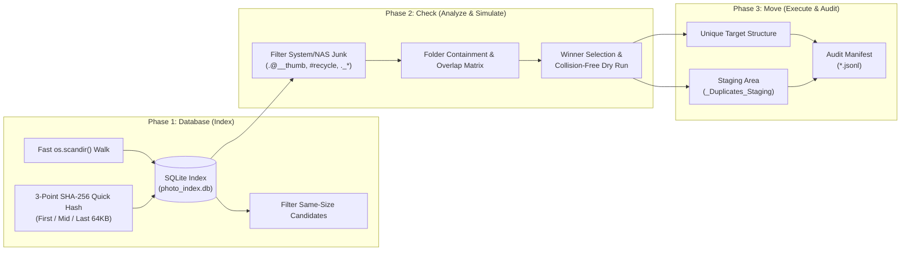

# Photo-Review: NAS Photo & Data Consolidation Toolset

A robust, production-grade Python toolset implementing the **"Database-Check-Move"** strategy for large-scale media deduplication and file consolidation across NAS (Network-Attached Storage) and SMB network drives.

---

## Architecture: The "Database-Check-Move" Strategy

Consolidating hundreds of thousands of photos, RAW files (`.NEF`, `.CR2`, `.ARW`), and personal archives across multiple network volumes without risking data loss requires decoupling discovery, planning, and execution:



Detailed documentation of this methodology is available in [database_check_move_strategy.md](database_check_move_strategy.md).

---

## Key Features & Safety Principles

- ⚡ **High-Speed Scanning over SMB**: Utilizes single-pass `os.scandir()` to extract directory entry stats directly from network packets without redundant roundtrips (~1,000 to 2,000 files/sec).
- 🔍 **Two-Tier Hashing**:
  - Eliminates >90% of files immediately via exact size grouping.
  - Computes 3-point SHA-256 checksums (First 64KB, Middle 64KB, Last 64KB) for exact collision detection without streaming multi-gigabyte media files over the network.
- 🛡️ **Zero Data Loss Guarantee**:
  - **No In-Place Deletion**: Duplicates and redundant backups are never permanently deleted (`rm -rf` / `os.remove`). They are moved to a review staging directory (`_Duplicates_Staging` / `_Duplicate_Storage`) preserving original relative folder hierarchies.
  - **Collision-Safe Renaming**: Target file collisions automatically append numeric counters (`_1`, `_2`) if files differ in size or hash.
  - **Read-Only & System Attribute Handling**: Windows `FILE_ATTRIBUTE_READONLY` bits are cleared automatically during moves.
  - **Long Path Support**: Prepends Windows Extended-Length Path prefixes (`\\?\`) to reliably manipulate deep paths exceeding the 260-character `MAX_PATH` limit.
- 📝 **100% Audit Logging**: Every filesystem action is recorded in an append-only JSON Lines manifest (`*.jsonl`) containing timestamps, action types, source paths, and target paths.

---

## Repository Structure & Script Overview

### 1. Discovery & Indexing
- `scan_photos.py`: Walks target drive/folder and builds SQLite database (`photo_index.db`) indexing `files` table.
- `scan_h_mcyen.py`: Indexes secondary drive/archive paths into `h_files` table.
- `hash_and_map.py`: Computes 3-point SHA-256 hashes for all size-collision candidates.

### 2. Analysis & Containment Checking
- `analyze_db.py`, `deep_dive.py`, `analyze_clean.py`: High-level inventory, extension breakdowns, and duplicate distribution.
- `check_pairs.py`, `check_depth3.py`, `inspect_subfolders.py`: Evaluates folder-level containment to distinguish complete backup clones from partial mixes.
- `classify_h_dirs.py`, `check_h_groups.py`, `inspect_h_details.py`, `inspect_h_unique_media.py`: Analyzes secondary drive directories against primary archive.

### 3. Simulation & Dry Run
- `simulate_plan.py`: Generates the complete canonical winner list and target paths without touching the filesystem.
- `verify_migration_plan.py`: Validates the simulation against edge cases, zero-byte files, and path collision risks.

### 4. Execution & Long-Path Recovery
- `execute_migration.py`: Executes the primary photo consolidation plan into `01_Chronological` and `02_Collections`, moving duplicates to `_Duplicates_Staging`.
- `execute_h_mcyen_consolidation.py`: Consolidates multi-year data folders and Google Drive snapshots into unified structures, staging duplicates to `_Duplicate_Storage`.
- `fix_readonly_h.py`: Clears stubborn Windows read-only filesystem attributes on SMB shares.
- `fix_long_paths_data.py`: Employs `\\?\` prefixing to move deep nesting paths that exceed Windows `MAX_PATH`.

---

## Requirements & Setup

```bash
# Clone the repository
git clone https://github.com/mingchinyen60/Photo-Review.git
cd Photo-Review

# Python 3.8+ is required (standard library only, no external pip dependencies needed)
python --version
```

---

## License
MIT License.
