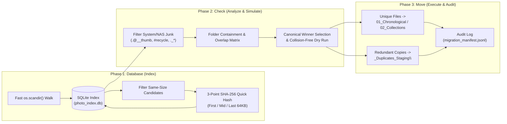

# The "Database-Check-Move" Strategy for Large-Scale Photo & Media Consolidation

## 1. Overview & Motivation
When consolidating hundreds of thousands of photos, RAW files (`.NEF`), and videos across network-attached storage (NAS / SMB shares) spanning multiple decades and historical folder conventions, direct file-by-file comparison or naive OS folder merging is slow, error-prone, and risks accidental data loss.

The **Database-Check-Move** strategy decouples **discovery**, **verification/planning**, and **execution** into three deterministic phases backed by a local SQLite index (`photo_index.db`) and an append-only JSON Lines audit manifest (`migration_manifest.jsonl`).



---

## 2. Phase 1: Database (Fast Metadata Indexing & Targeted Hashing)

### Step 1.1: Single-Pass `os.scandir()` Metadata Walk
- **Why**: Over SMB/network drives (`P:\`, `H:\`), reading file contents or calling `os.path.getsize()` separately after `os.listdir()` triggers redundant network round-trips. Python's `os.scandir()` retrieves `DirEntry.stat()` attributes (`size`, `mtime`, `ctime`, `is_dir`) directly from the directory listing response.
- **Performance**: Indexed **177,141 files (409.71 GB)** on `P:\` in **93 seconds**, and **860,817 files (1,202.85 GB)** on `H:\mcyen` in **19 minutes**.
- **Schema (`files` / `h_files`)**:
  - `id`, `path`, `top_folder`, `parent_rel_dir`, `rel_path`, `name`, `ext`, `size`, `mtime`, `ctime`, `is_media`, `quick_hash`
  - Indexed on `(size)`, `(name, size)`, and `(parent_rel_dir)` for millisecond SQL queries.

### Step 1.2: Two-Tier Duplicate Detection (`Size` → `3-Point SHA-256 Quick Hash`)
- **Tier 1 (Size & Filename Filter)**: Files with unique byte sizes (`size > 0`) cannot be byte-identical duplicates of any other file. Only files sharing an identical `size` require content hashing.
- **Tier 2 (3-Point SHA-256 Quick Hash)**: Instead of reading 30 MB `.NEF` RAW files or multi-gigabyte `.MP4` videos in full over the network, compute a SHA-256 digest of:
  - First `64 KB` (`0 .. 65536`)
  - Middle `64 KB` (`size // 2 .. size // 2 + 65536`)
  - Last `64 KB` (`size - 65536 .. size`)
  - *(For files $\le 192\text{ KB}$, hash the entire file.)*
- This verifies byte-level identity across tens of thousands of candidate duplicates while reducing network I/O by >98%.

---

## 3. Phase 2: Check (Junk Filtering, Folder Containment & Dry-Run Simulation)

### Step 2.1: Isolate System, NAS, and OS Junk Before Comparing Folders
Before calculating folder duplication ratios, explicitly filter out non-user artifacts that distort file counts:
1. **NAS Thumbnail Caches**: QNAP `.@__thumb` directories (`115,007 files` on `P:\` — 65% of all files on disk!).
2. **NAS Recycle Bin**: `#recycle`.
3. **OS Metadata & Resource Forks**: `Thumbs.db`, `.DS_Store`, `desktop.ini`, `Picasa.ini`, `ZbThumbnail.info`, and macOS AppleDouble resource forks (`._*`, always `4,096 bytes`).
4. **Zero-Byte Stubs**: `0-byte` placeholder files from interrupted cloud syncs (e.g., `0-byte` `.NEF` stubs in `GoogleDrive\YenFamily`).

### Step 2.2: Folder-Level Containment Analysis & Thresholding
Query the SQLite database to classify every directory by its **Real Media Count** and **Duplication Ratio**:
- **Minimum Threshold Rule (`> 10` photo files)**: When scanning mixed data/backup drives (such as `H:\mcyen`), ignore folders with $\le 10$ media files so small document attachments aren't disturbed, and exclude software/web-template asset directories (`*_files`, `*.files`, web design e-books).
- **100% Duplicated Folders**: Every real media file in the folder already exists in the canonical archive (e.g., `102D7100`, `2011Tailand`, `H:\mcyen\D7100\2023Europe2`).
- **Partially Duplicated Folders**: A folder contains both duplicated photos and unique photos (e.g., `Home\2025Europe` vs `Travel\Croatia2025`, or `H:\mcyen\Data\Photo\D70`).
  - **Rule**: Stage the duplicated files into `_Duplicates_Staging\`, and route the remaining **unique** files into their proper destination in the organized hierarchy so zero unique photos are left behind or lost.

### Step 2.3: Deterministic Priority Scoring & Dry-Run Collision Check
When multiple copies of the same photo exist across different folders, assign a deterministic **Source Priority Score** to pick the canonical keeper:
1. **Highest Priority (`80–85`)**: Named chronological event/trip folders (`Photos_2013\2013-05-25南投日月潭2日遊`) and curated thematic collections (`00新莊國小`, `2019北一女中三十重聚`).
2. **Medium Priority (`60–75`)**: Catch-all folders (`Home`, `Travel`).
3. **Lowest Priority (`10–25`)**: Raw SD card folder dumps (`101D7100`, `112D7100`, `104_PANA`, `Casico`) and root-level duplicate copies.

Run a **100% in-memory dry-run simulation** (`simulate_plan.py` / `verify_migration_plan.py`) before touching a single file on disk to verify:
- Every unique file is accounted for (`Keep + Stage_Dup == Total Real Files`).
- Any destination filename collisions (two different photos with the same filename `DSC_0001.JPG` mapping to the same target folder) are automatically disambiguated with a parent-folder suffix before execution.

---

## 4. Phase 3: Move (Safe Staging, Bulk Optimization & Audit Manifest)

### Step 3.1: Non-Destructive Staging (`_Duplicates_Staging\`)
- **Never `DELETE` during reorganization**: Move redundant copies into `P:\_Duplicates_Staging\<source_relative_path>` instead of deleting them in place.
- **Why**:
  1. Same-volume moves (`P:\...` → `P:\_Duplicates_Staging\...`) are instantaneous filesystem metadata renames (`os.rename`) with zero data transfer.
  2. Preserving the original relative path inside `_Duplicates_Staging\` makes every operation 100% inspectable and reversible.
  3. The user can review the clean archive first and delete `_Duplicates_Staging\` at their convenience to reclaim space (**205.83 GB** total staged across `P:\` and `H:\mcyen`).

### Step 3.2: Bulk Directory Moves & Read-Only Handling
- **Bulk Folder Rename for Thumbnail Caches**: Instead of executing 115,000 individual SMB file renames for `.@__thumb` files, rename the 641 `.@__thumb` parent directories as whole folders first (completed in **62 seconds** instead of hours).
- **Read-Only Attribute Handling on Cross-Drive Moves**: Old CD/DVD/USB backups often carry the Windows Read-Only flag (`stat.S_IREAD`), which causes `shutil.move()` across drives (`H:\` → `P:\`) to copy the file to `P:\` and then fail with `WinError 5 (Access Denied)` when unlinking the source on `H:\` (or `Errno 13` on retry if the destination copy inherited the read-only flag).
  - **Fix**: Clear the read-only flag (`os.chmod(path, stat.S_IWRITE)`) on both source and destination before unlinking or overwriting, and verify `os.path.getsize(src) == os.path.getsize(dst)` before removing already-copied source files.

### Step 3.3: Unified Target Hierarchy & RAW Separation
- **`01_Chronological\YYYY\YYYY-MM_Event\`**: Primary timeline for all dated events, travels, and camera imports.
- **`02_Collections\<Category>\`**: Cross-year collections for family growth albums (`Family_Albums`), school (`School_新莊國小`), reunions (`Reunion_2019北一女中三十重聚`), and work (`Work_Company_CTS`).
- **`RAW\` Subfolder Rule**: Automatically route camera RAW files (`.NEF`) and sidecar parameters (`.nksc`) into a `RAW\` subfolder inside each event folder so everyday JPG/video browsing stays fast and uncluttered while keeping RAW originals paired with their event.

### Step 3.4: Complete Audit Trail (`JSONL` + `SQLite`)
Every file operation is logged to an append-only JSON Lines manifest (`migration_manifest.jsonl` and `h_mcyen_migration_manifest.jsonl`) recording:
```json
{"id": 12345, "action": "KEEP", "src": "old\\rel\\path.jpg", "dst": "01_Chronological\\2023\\...", "size": 4512300, "note": ""}
```
This guarantees complete traceability for every single file across both drives.
